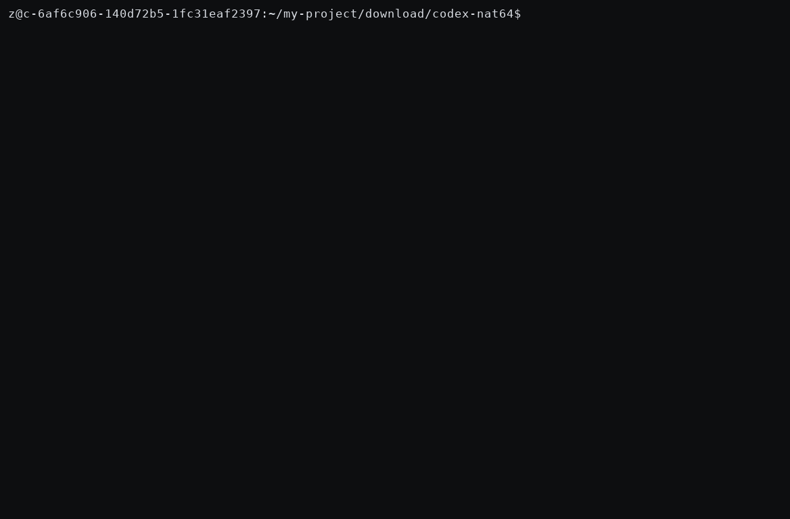

# NAT64 SSRF в сетевом прокси-песочнице OpenAI Codex

> **Коротко:** прокси, который обязан не пускать агента Codex в приватные сети, пропускает запросы
> в них — достаточно спрятать приватный IPv4 внутри IPv6-адреса RFC 6052 NAT64 (`64:ff9b::/96`),
> который классификатор не умеет инспектировать.


[English](README.md) | **Русский**

| | |
|---|---|
| **Компонент** | `codex-rs/network-proxy` — прокси песочницы, принудительно блокирующий обращения агента к приватным/внутренним адресам |
| **Коммит** | `c0cc9fc820f62e4dbdde68214dd6d792d6c8a7ee` (`main`, проверено 2026-11) |
| **Класс** | SSRF / обход сетевой политики песочницы — слепой край IPv6 transition-механизмов |

---

## Живое демо

Реальные бинарники `codex-network-proxy`, от начала до конца: уязвимая сборка обходит гейт
(T2 = 200 от приватного бэкенда), исправленная блокирует (T2 = 403), легитимный NAT64 работает (T3 = 200).



MP4: [`demo/demo.mp4`](demo/demo.mp4) · сырая запись: [`demo/demo.cast`](demo/demo.cast)

## Как выглядит обход

```text
allowlist:      web.internal.corp                 ← в политике разрешён только этот хост
DNS64-ответ:    web.internal.corp   AAAA  64:ff9b::a14:a      ← внутри спрятан 10.20.0.10
классификатор:  64:ff9b::a14:a  →  to_ipv4() = None  →  "публичный"  →  РАЗРЕШИТЬ
подключение:    NAT64-шлюз: 64:ff9b::a14:a  →  10.20.0.10
итог:           HTTP 200 от приватного внутреннего сервера   ← ОБХОД
```

DNS64-резолверы (RFC 6147) синтезируют AAAA-записи ровно такой формы для IPv4-only имён,
а NAT64-шлюзы (RFC 6146) доставляют пакет по встроенному адресу. Это стандартный механизм
IPv6-only и dual-stack корпоративных сетей для доступа к легаси-IPv4-инtranet'у.

## Причина

`codex-rs/network-proxy/src/policy.rs`, дословно на `c0cc9fc`:

```rust
fn is_non_public_ipv6(ip: Ipv6Addr) -> bool {
    if let Some(v4) = ip.to_ipv4() {
        return is_non_public_ipv4(v4) || ip.is_loopback();
    }
    ip.is_loopback()
        || ip.is_unspecified()
        || ip.is_multicast()
        || ip.is_unique_local()
        || ip.is_unicast_link_local()
}
```

`Ipv6Addr::to_ipv4()` декодирует **только** IPv4-mapped (`::ffff:a.b.c.d`) и устаревшие
IPv4-compatible адреса. Для `64:ff9b::a14:a` он возвращает `None`, и ни одна из последующих
проверок не срабатывает (WKP — глобальный unicast) — адрес, несущий приватный `10.20.0.10`
в младших 32 битах, классифицируется как **публичный**.

## Доказательства — четыре независимых уровня

| # | Уровень | Результат |
|---|---------|-----------|
| 1 | Анализ исходника `policy.rs` @ `c0cc9fc` | обработки `64:ff9b::/96` нет |
| 2 | **Stage A** — вербатим-функция на rustc 1.95.0 | `64:ff9b::a14:a` → `is_non_public_ip() == false` |
| 3 | **PoC-тесты** в реальном крейте | уязвимое дерево: `347 passed; 1 failed` (падает только PoC); с фиксом: `348 passed; 0 failed` |
| 4 | **Stage B** — живой дифференциальный тест реального бинарника в netns | уязвимый: **T2 = 200 ОБХОД**; фиксированный: T2 заблокирован, легитимный NAT64 остался 200 |

<details>
<summary><strong>Матрица Stage B</strong> — реальный бинарник, все имена в allowlist</summary>

| Тест | Цель | Разрешается в | Уязвимый | С фиксом |
|------|------|---------------|----------|----------|
| T1_direct_private_ipv4 | `http://10.20.0.10/` | литерал | **403 блок** | **403 блок** |
| T2_dns64_synthesized | `http://web.internal.corp/` | AAAA `64:ff9b::a14:a` → `10.20.0.10` | **200 — ОБХОД** | **403 блок** |
| T3_plain_A_private | `http://plainv4.internal.corp/` | A `10.20.0.10` | **403 блок** | **403 блок** |
| T4_dns64_public | `http://publicnat.internal.corp/` | AAAA `64:ff9b::808:808` → `8.8.8.8` | 200 | 200 |

Тело ответа обхода — приватный бэкенд действительно ответил:

```text
Intra-VPC Connectivity Verified! backend=10.20.0.10 route=web.internal.corp
```

Сырые логи: [`stage_b_local/out-vulnerable/`](stage_b_local/out-vulnerable/run.txt) и
[`stage_b_local/out-fixed/`](stage_b_local/out-fixed/run.txt).
</details>

## Как воспроизвести

### A. 30 секунд — классификатор

```bash
rustc -O stage_a_classifier_test.rs -o stage_a && ./stage_a
# ожидаемо: VERDICT: CONFIRMED - 64:ff9b::a14:a ... is classified as PUBLIC
```

### B. PoC-тесты в крейте

```bash
git clone https://github.com/openai/codex && cd codex/codex-rs
git checkout c0cc9fc820f62e4dbdde68214dd6d792d6c8a7ee
git apply ../nat64_codex_positive_poc.patch
cargo test -p codex-network-proxy          # PoC-тест ПАДАЕТ на уязвимом дереве
git apply ../nat64_codex_fix.patch
cargo test -p codex-network-proxy          # 348 passed; 0 failed
```

### C. Полный end-to-end (Stage B — без root, без облака)

Подробные команды и устройство стенда — в [английском README, раздел Reproduce it](README.md#reproduce-it).
Коротко: собрать прокси (исключив v8-крейты из workspace), затем дважды прогнать
`stage_b_local/run.sh` — с уязвимым и исправленным бинарником — внутри `unshare -rn`;
стенд эмулирует DNS64-резолвер и NAT64-маршрут (`ip -6 route add local 64:ff9b::/96 dev lo`).

## Фикс

`nat64_codex_fix.patch` — перед классификацией декодировать WKP:

```rust
let o = ip.octets();
if o[0..12] == [0x00, 0x64, 0xFF, 0x9B, 0, 0, 0, 0, 0, 0, 0, 0] {
    return is_non_public_ipv4(Ipv4Addr::new(o[12], o[13], o[14], o[15]));
}
```

плюс два регрессионных теста (приватная вставка должна блокироваться, публичная — оставаться
разрешённой). T4 в обоих прогонах подтверждает: легитимный NAT64 после фикса работает.

## Что делать дальше — план репорта

В [SECURITY.md](https://github.com/openai/codex/security/policy) OpenAI просит приватно репортить
через их программу на Bugcrowd; скоуп явно включает *"Codex security boundaries, including
sandboxing, approvals, and **network controls**"* — наш кейс как раз обход network-control.

| Шаг | Канал | Статус |
|-----|-------|--------|
| 1. Репорт вендору | [OpenAI на Bugcrowd](https://bugcrowd.com/engagements/openai) | не отправлен |
| 2. CVE | [GitHub Security Advisory](https://github.com/BOSSMANIWAY/codex-nat64/security/advisories/new) (GitHub — CNA) | не запрошен |
| 3. Публичный advisory | этот репозиторий | опубликован |

Порядок действий:

1. **Сначала Bugcrowd.** Приложить: TL;DR + root cause + матрицу Stage B из этого README,
   треки воспроизведения A–C и ссылку на репозиторий. Предлагаемая критичность: **High**
   (обход сетевой политики песочницы, условие — наличие DNS64/NAT64). Bugcrowd даёт safe harbor.
2. **Не** открывать публичный issue в `openai/codex` с деталями эксплойта до выхода фикса —
   политика явно просит приватный репорт.
3. **Запросить CVE** через приватный GitHub Security Advisory этого репозитория; держать приватным
   до выхода патча вендора, потом опубликовать со ссылкой на фикс.
4. **Окно раскрытия:** стандартные 90 дней; обновлять таблицу статусов по ходу ответа вендора.

## Карта репозитория

| Путь | Что это |
|------|---------|
| [`README.md`](README.md) | Полная английская версия |
| [`stage_a_classifier_test.rs`](stage_a_classifier_test.rs) | Автономный вербатим-тест классификатора (трек A) |
| [`nat64_codex_positive_poc.patch`](nat64_codex_positive_poc.patch) | Тесты, падающие на уязвимом дереве (трек B) |
| [`nat64_codex_fix.patch`](nat64_codex_fix.patch) | Фикс + те же тесты (трек B) |
| [`stage_b_local/`](stage_b_local/) | Стенд end-to-end: `run.sh`, DNS64-резолвер, бэкенд, конфиг (трек C) |
| [`stage_b_local/out-vulnerable/`](stage_b_local/out-vulnerable/run.txt) | Сырые логи обхода (T2 = 200) |
| [`stage_b_local/out-fixed/`](stage_b_local/out-fixed/run.txt) | Логи исправленной сборки (T2 = 403) |
| [`evidence/`](evidence/) | Вывод Stage A, оба `cargo test` прогона, журнал верификации |

*Проверено 2026-11-13, Linux x86_64, rustc/cargo 1.95.0. Публикация в defensive-целях с
соблюдением этикета координированного раскрытия.*
